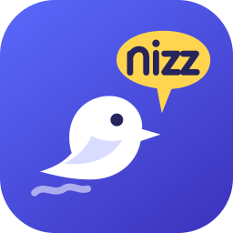
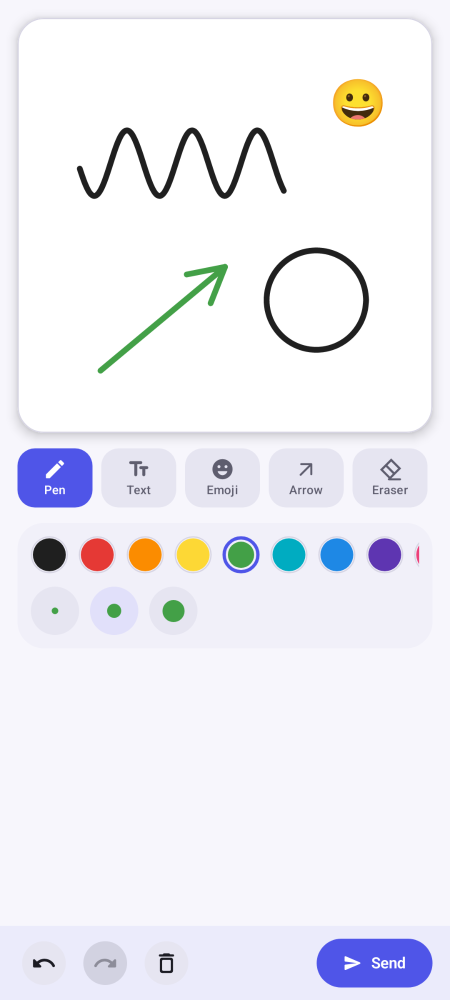
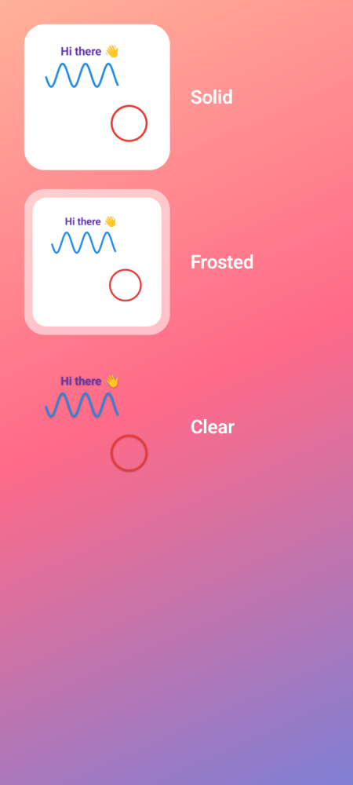
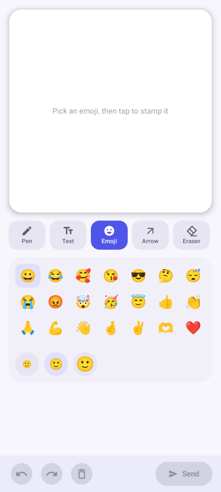
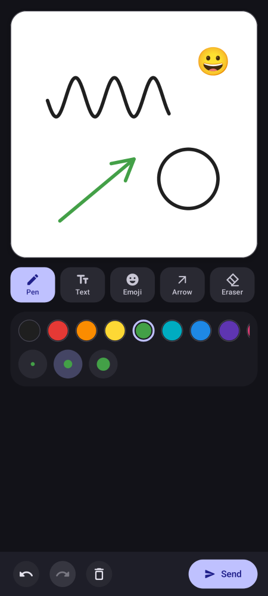
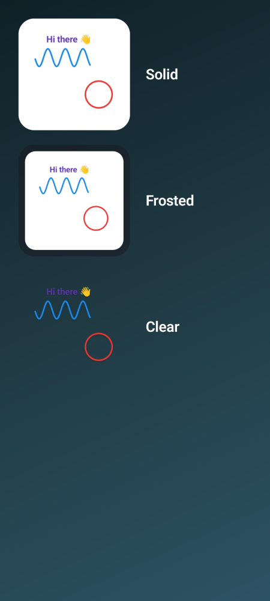

<p align="center">
  
</p>

<h1 align="center">Duoodo</h1>

<p align="center">
  <b>Little doodles for your favourite person.</b><br>
  Draw something, hit send, and it appears on their home screen a few seconds later.<br>
  Private by design: no accounts, no servers of ours, end-to-end encrypted.
</p>

<p align="center">
  
  &nbsp;
  
  &nbsp;
  
</p>

---

## Why Duoodo?

Texting is great, but sometimes you want to send something a bit more *you*: a quick sketch of
your coffee, an arrow pointing at "tonight?", a wobbly heart, a silly face. Duoodo is a tiny app
for exactly that, between exactly **two people**.

You draw. Your partner glances at their home screen and there it is, sitting in a widget next to
their clock. No feed, no likes, no history piling up. Just the latest little note from you,
replaced the moment you send a new one.

It was built with one firm rule: **nobody else gets to see it.** Not us, not an ad network, not the
servers that carry the message.

## Features

**Drawing that's actually fun**
- ✏️ **Pen**, 🖍 **Marker** (soft, see-through highlighter) and 🌈 **Rainbow** (every stroke cycles through colours)
- ➡️ **Arrows**, **lines**, **boxes** and **circles** for pointing things out
- 🔤 **Text** in three sizes and any colour, with emoji support
- 😀 **Emoji stamps**: pick one of 60 and tap to place it
- 🧽 **Eraser**, **undo / redo**, and smooth curves so your lines look hand-drawn, not jagged

**Arrives in seconds, even when the app is closed**
- **Instant delivery** keeps a light connection open, so a new doodle lands on your partner's
  widget within a few seconds. It uses a silent notification, as Android requires for anything
  running in the background.
- Prefer to save battery? Switch it off and Duoodo checks about every 10 minutes instead.

**A widget that fits your wallpaper**
- **Solid**: a clean white card.
- **Frosted**: a translucent card that lets your wallpaper glow through.
- **Clear**: just the ink, floating on your wallpaper.

**Feels at home on your phone**
- Light and dark themes that follow your system setting.
- **Save** a doodle you love as a PNG in its own `Pictures/Duoodo` folder, or **Clear** it.
- Pair by **scanning a QR code** or by **copying a code** over WhatsApp, Signal, or anything else.

<p align="center">
  
  &nbsp;
  
  &nbsp;
  
  &nbsp;
  
</p>

## How it works (the short version)

1. **Pair once.** One of you taps **Invite my partner** and shows a QR code (or copies a code).
   The other scans it or pastes it. A few seconds later you're connected, and you stay connected
   until one of you taps **Unpair**.
2. **Draw and send.** Your doodle is encrypted *on your phone* with a key only the two of you have.
3. **It travels through public relays.** These are volunteer-run servers on the open
   [Nostr](https://nostr.com) network. They pass along a scrambled blob they can't open, and they
   can't tell who it's from or who it's for.
4. **Your partner's phone picks it up**, unlocks it, and shows it in the app and on the widget.

There's no Duoodo server anywhere in this picture. No sign-up, no phone number, no email.

## Privacy & security

Duoodo collects nothing, because there's nowhere for it to go.

| | |
|---|---|
| **End-to-end encrypted** | Every doodle is sealed with ChaCha20-Poly1305 using keys agreed through X25519 when you pair. Only your partner's phone can open it. |
| **No identity** | No account, phone number or email. Each direction uses its own throwaway signing key that changes every day. |
| **Same size every time** | Doodles are padded to fixed sizes, so a relay can't even guess how detailed your drawing was. |
| **Leaves no trail** | Only the latest doodle exists. Sending a new one replaces it, and every message expires from the relays after 7 days. |
| **Can't be spoofed** | Every message is authenticated. Anything that isn't from your partner is silently ignored. |
| **Pairing can't be hijacked** | An invite works once, expires after 24 hours, and the inviting phone must confirm. A safety-code (6 emojis) lets you double-check nobody is in the middle. |
| **Tight sandbox** | Only internet and notifications, plus what instant delivery needs to run in the background. No camera (the QR scanner runs inside Google Play services), no storage, no contacts, no location. Backups are disabled, and keys live in the Android Keystore. |
| **Tells you when it's over** | If your partner unpairs, your app is told, removes their last doodle and stops sending. |

What a relay *can* see: that some phone, at some IP address, sent an encrypted blob at some time.
That's the same metadata any internet app exposes. If you want to hide even that, route your
phone through a VPN or Tor.

## Data & battery

- **Each doodle is about 1–4 KB.** A single WhatsApp photo is roughly a hundred times bigger.
- **Staying connected costs about 1–2 MB a month**: a tiny "still here?" ping once a minute.
- **Battery impact is small.** If your phone is aggressive about closing apps (Xiaomi, Samsung,
  Oppo…), tap **Settings → Allow background running** so deliveries aren't paused.

## Install

Grab the latest signed APK from the
[Releases page](https://github.com/dil2743/Duoodo/releases), open it on your phone, and allow
installing from your browser if Android asks. **Both of you need the app.**

Requirements: Android 8.0 or newer, with Google Play services for QR scanning (you can always paste
the code instead).

## FAQ

**Can more than two people share a pairing?**
No. Duoodo is deliberately one-to-one.

**Is there a history of old doodles?**
No, only the latest one, by design. If you want to keep one, tap **Save**.

**What if my partner's phone is off when I send?**
The doodle waits (encrypted) on the relays for up to 7 days and shows up as soon as their phone is
back online.

**Does it work on iPhone?**
Not yet. Duoodo is Android-only for now.

**What happens if I uninstall?**
Your keys are gone with the app, so you'd pair again with a new invite.

---

## For developers

<details>
<summary><b>Build, test and project layout</b></summary>

### Build

Requires JDK 17 and the Android SDK (platform 35).

```bash
./gradlew assembleDebug          # debug APK in app/build/outputs/apk/debug/
./gradlew testDebugUnitTest      # unit tests: crypto vectors, codec, pairing, transport, tools
./gradlew recordPaparazziDebug   # re-render the screenshots in app/src/test/snapshots/images
```

Release builds and publishing are described in [docs/PUBLISHING.md](docs/PUBLISHING.md).

### Stack

Kotlin · Jetpack Compose (Material 3) · Glance (widget) · WorkManager · OkHttp WebSockets ·
BouncyCastle (X25519, ChaCha20-Poly1305, HKDF, BIP-340 Schnorr) · ZXing + ML Kit code scanner ·
Paparazzi (screenshot tests).

### Layout

```
app/src/main/java/app/duoodo/
├── crypto/     X25519, AEAD, HKDF, BIP-340 Schnorr (pure JVM, test-vector checked)
├── model/      Doodle, Stroke, TextMark and the compact binary codec
├── pairing/    Invite codes, two-way confirmed handshake, safety emojis
├── nostr/      Event signing, relay pool (quorum-based), live subscriptions
├── sync/       Encrypted transport, live service, background check, inbox
├── data/       Keystore-encrypted secrets, latest doodle, settings, PNG export
├── render/     One renderer shared by the app canvas and the widget
├── widget/     Glance home-screen widget (Solid / Frosted / Clear)
└── ui/         Compose screens, drawing tools, theme
```

### Protocol, in one paragraph

Pairing exchanges X25519 keys through a one-time invite (public key + 256-bit secret + timestamp).
The responder's key travels encrypted under the invite secret, and the initiator confirms under
the new root key. HKDF derives per-direction message keys and per-day secp256k1 signing keys.
Doodles are encoded compactly (normalized u16 coordinates), padded to 1/4/16/48 KB buckets,
sealed with ChaCha20-Poly1305 and published as NIP-78 parameterized-replaceable events with
NIP-40 expiry to several public relays. Unpairing publishes an encrypted "goodbye" in the same
slot.

</details>

## Credits

Made with ☕ and a lot of squiggles by **Dilshad** · [fire.dilshad@gmail.com](mailto:fire.dilshad@gmail.com)

If Duoodo made someone smile, that's the whole point.
